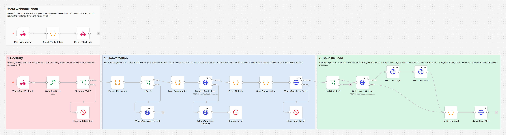
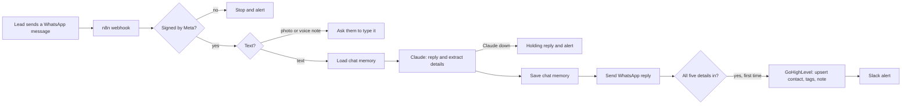

# WhatsApp AI Lead Qualification Bot: Claude + GoHighLevel

A WhatsApp assistant that chats with new leads, collects five qualification details, scores the lead and saves it to GoHighLevel with a note and a Slack alert. Built with n8n and Claude.



## The problem

People who message a business on WhatsApp expect an answer in minutes. Most get one hours later, after they have already messaged a competitor. And when someone does reply, the useful details (who they are, what they need, their budget and timeline) stay buried in a chat thread instead of landing in the CRM.

## What this does

1. **Answers every new message within seconds**, day or night.
2. **Qualifies the lead in a natural chat.** It asks for their name, company, main challenge, monthly budget and timeline, one question at a time. If they answer several at once, it skips ahead.
3. **Remembers the conversation** between messages, so nobody has to repeat themselves.
4. **Scores the lead from 0 to 10** from budget, timeline and need.
5. **Saves the lead to GoHighLevel** once all five details are in. The contact is upserted by phone number, so there are no duplicates. It gets tags with the score and a note with every detail plus a short summary for the sales rep.
6. **Alerts the team in Slack** with a direct link to the contact.
7. **Fails safely.** Forged webhooks are rejected. If Claude is down, the lead gets a holding reply. A failed GoHighLevel save is flagged in Slack and retried on the lead's next message.

## How it works



Meta sends one GET request to the same URL when you connect the webhook. The three nodes at the top of the canvas answer it with the challenge if the verify token matches.

The webhook answers Meta right away and does the work afterwards, so Meta never times out and retries. Meta can still deliver the same message twice now and then, so every message ID is remembered and repeats are skipped.

## Workflow at a glance

| Step | Nodes | What it does |
|---|---|---|
| Meta check | Meta Verification, Check Verify Token, Return Challenge | Answers Meta's one time verification request |
| 1 | WhatsApp Webhook | Receives every message and receipt from Meta (POST, raw body kept for the signature check) |
| 2 | Sign Raw Body, Signature Valid?, Stop: Bad Signature | Recomputes Meta's HMAC SHA256 signature with your app secret and stops anything that does not match |
| 3 | Extract Messages | Reads sender, profile name and text. Ignores receipts and reactions, and joins several messages from one person into one turn |
| 4 | Is Text?, WhatsApp: Ask For Text | Photos, voice notes and documents get a polite request to type it out |
| 5 | Load Conversation | Loads the chat memory, skips repeat deliveries and builds the Claude request |
| 6 | Claude: Qualify Lead | One call per message. Claude answers through a forced tool call, so the reply and the details always come back as clean JSON |
| 7 | WhatsApp: Send Fallback, Stop: AI Failed | If Claude still fails after 3 tries, the lead gets a holding reply and you get an alert |
| 8 | Parse AI Reply | Merges the new details with what was already known, scores the lead and checks if it is complete |
| 9 | Save Conversation | Saves the memory (last 20 turns) and clears chats with no activity for 7 days |
| 10 | WhatsApp: Send Reply, Stop: Reply Failed | Sends the reply. If WhatsApp refuses it, the alert includes the lead's details so nothing is lost |
| 11 | Lead Qualified? | True once per lead, when all five details are in |
| 12 | GHL: Upsert Contact, GHL: Add Tags, GHL: Add Note | Saves the lead in GoHighLevel |
| 13 | Build Lead Alert, Slack: Lead Alert | Marks the lead as saved and posts the alert, or a "not saved" warning if GoHighLevel failed |

## Lead score

| Budget | Points | Timeline | Points |
|---|---|---|---|
| Above $2,000 a month | 4 | ASAP | 4 |
| $500 to $2,000 a month | 3 | 1 to 3 months | 3 |
| Under $500 a month | 1 | 3 to 6 months | 2 |
| | | Just exploring | 1 |

Add 2 points when the lead names a clear challenge. A score of 7 or more adds the `hot-lead` tag. Claude only sorts each answer into one of these bands; the points are added up in code, so the same answers always get the same score and the rules are easy to change.

## What the team gets

A Slack alert like this one, taken from the test run (all data made up):

```
*New WhatsApp lead* (score 9/10, hot lead)

Name: Jamie Rivera
Company: Rivera Roofing
Challenge: Missed calls, leads going cold
Budget: Around $1,500 a month
Timeline: ASAP
WhatsApp: +15553334444
Open in GoHighLevel: https://app.gohighlevel.com/v2/location/.../contacts/detail/...
```

In GoHighLevel, the contact gets the tags `whatsapp-lead`, `ai-qualified`, `score-9` and `hot-lead`, plus a note with the same details and Claude's two line summary for the sales rep.

## Setup

**You need:** self-hosted n8n reachable over HTTPS, a Meta developer app with the WhatsApp Cloud API, an Anthropic API key, a GoHighLevel sub-account and, optionally, a Slack incoming webhook.

1. Import `workflow/whatsapp-lead-qualification-bot.json` into n8n. For failure alerts, also import `workflow/error-alert-slack.json`.
2. Add the variables below to your n8n environment and restart n8n. The nodes read them with `$env`, so self-hosted n8n needs `N8N_BLOCK_ENV_ACCESS_IN_NODE=false`. (n8n Cloud does not allow `$env`. There, replace `$env.` with `$vars.` and create the same names under Variables.)
3. In the bot's workflow settings, choose the error alert workflow as its **Error Workflow**.
4. Activate the workflow.
5. In your Meta app, set the callback URL to `https://YOUR-N8N-DOMAIN/webhook/whatsapp-lead-bot`, enter your verify token and subscribe to the `messages` field. Step by step, including how to get a permanent token: [docs/meta-setup.md](docs/meta-setup.md).

| Variable | Required | Where to find it |
|---|---|---|
| `WHATSAPP_TOKEN` | yes | Meta app → WhatsApp → API Setup. Use a permanent System User token for production; the temporary one expires after 24 hours |
| `WHATSAPP_PHONE_NUMBER_ID` | yes | Meta app → WhatsApp → API Setup |
| `WHATSAPP_APP_SECRET` | yes | Meta app → App settings → Basic → App secret |
| `WHATSAPP_VERIFY_TOKEN` | yes | Any long random string you make up. Paste the same value in the Meta webhook settings |
| `WHATSAPP_API_VERSION` | no | Graph API version, default `v23.0` |
| `ANTHROPIC_API_KEY` | yes | console.anthropic.com → API keys |
| `ANTHROPIC_MODEL` | no | Default `claude-sonnet-5`. `claude-haiku-4-5-20251001` is cheaper and faster |
| `BUSINESS_NAME` | no | The business name the assistant uses (default "our team") |
| `BUSINESS_ABOUT` | no | One line about the business, for example "a digital marketing and automation agency" |
| `GHL_API_KEY` | yes | GoHighLevel → Settings → Private Integrations, with the View Contacts and Edit Contacts scopes (token starts with `pit-`) |
| `GHL_LOCATION_ID` | yes | GoHighLevel → Settings → Business Profile |
| `GHL_APP_URL` | no | Your white label app domain, used for the contact link in Slack (default `https://app.gohighlevel.com`) |
| `SLACK_WEBHOOK_URL` | no | A Slack incoming webhook for lead and error alerts. Leave it empty to skip Slack |

To change the questions or the budget options, edit the prompt in the **Load Conversation** node.

## Testing

The workflow was tested end to end on n8n 2.19.5 against **mock WhatsApp, Claude, GoHighLevel and Slack APIs**, so no real account was touched. The mock Claude returns scripted answers, but it rejects malformed requests the way the real API does. The request format was also checked against the real Claude API through Anthropic's free token counting endpoint, which validates the request without generating anything or using credits.

All 22 checks across 14 scenarios pass:

| Scenario | Result |
|---|---|
| Meta verification, right token / wrong token | Challenge returned with 200 / refused with 403 |
| Forged webhook (wrong signature, no signature) | Stopped at the signature check; Claude and WhatsApp never called |
| Delivery receipt | Ignored |
| Photo instead of text | Polite request to type it, no Claude call |
| Full six message chat | Six replies in order, full history sent to Claude each time, one contact upserted with tags (score 9/10, hot lead), note and Slack alert |
| Same message delivered twice | Second copy ignored |
| Qualified lead writes again | Friendly reply, no second lead |
| Lead answers everything in one message | Qualified in one step, score 10/10 |
| Two messages in one webhook | Joined into one turn, one reply |
| Claude down (529 overloaded) | Retried 3 times, holding reply sent, run flagged for the alert |
| Claude back | Chat continues normally |
| GoHighLevel down when the lead completes | Retried 3 times, Slack says "NOT saved", the lead still got a reply |
| GoHighLevel back | The save is retried on the lead's next message and succeeds |
| WhatsApp rejects the reply | Retried 3 times, run flagged with the phone number |

Full results, the requests the workflow sent and the v1 findings: [docs/test-report.md](docs/test-report.md). Run the same tests yourself with [tests/e2e_mock_test.py](tests/e2e_mock_test.py).

## What changed in v2

Testing v1 against the mocks showed that it never replied to anyone. With that fixed, finished leads still never reached GoHighLevel or Slack, and Meta's webhook verification could not pass. v2 fixes all three, plus seven more issues found in review, and adds the security and failure handling described above. Details in [CHANGELOG.md](CHANGELOG.md).

## Cost

Each incoming message is one Claude call of roughly 1,500 to 2,000 input tokens (measured with Anthropic's token counter) and 100 to 300 output tokens. A lead who finishes in six messages uses about 10,000 input and 1,500 output tokens. Setting `ANTHROPIC_MODEL=claude-haiku-4-5-20251001` lowers the cost further.

## Limitations and next steps

- Chat memory lives in n8n's workflow static data. That is fine at normal volume, but n8n saves it as one block per workflow, so two messages processed at the same moment can overwrite each other's memory. At high volume, move the memory to Redis, Postgres or an n8n data table.
- Two messages sent a second apart arrive as two webhooks and get two replies. A short wait and merge step would fix that.
- API keys are read from environment variables. For production, move them into n8n credentials so they never appear in the workflow.
- Text only. Voice notes get a request to type; transcribing them would be a natural next step.
- The budget options are written for a business that sells monthly services.
- WhatsApp only allows free form replies within 24 hours of the lead's last message. The bot always answers right away, so this is never an issue here, but follow ups sent later need approved message templates.

## About

Built by **Romiel Inolino**, AI and CRM Automation Specialist working with GoHighLevel, Monday.com, ClickUp, n8n, Make and Zapier.
Portfolio and case studies: [romielwillautomate.dev](https://romielwillautomate.dev)

This repository is a portfolio implementation. Credentials, API keys and customer data are not included, and all test data is made up.
